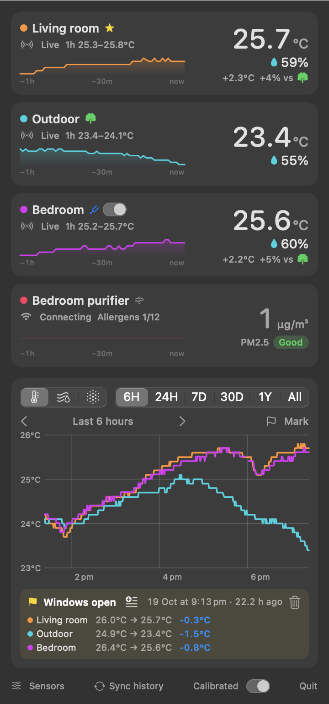
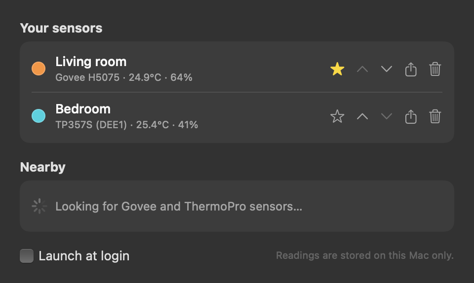

# sensor-tray

A native macOS menu bar app for Bluetooth thermo-hygrometers. It shows the temperature and humidity of your main sensor in the menu bar, and a click opens every sensor with a chart of its history. It replaces juggling the Govee and ThermoPro phone apps.

<p align="center">
  
</p>

## Supported sensors

| Brand | Models | Live readings | Onboard history |
|---|---|---|---|
| Govee | H5075, H5072 | ✓ (advertisements, every few seconds) | ✓ 20 days, minute resolution |
| ThermoPro | TP357S | ✓ | ✓ 20 days, minute resolution |
| ThermoPro | TP357 / other TP3xx | ✓ | ✓ 24 h by minute + 7 days hourly |

You can add as many sensors of these models as you like and name them.

## Features

- **Menu bar**: the main (★) sensor's `25.1°  62%`, dimmed when the reading is more than 10 minutes old.
- **Popover**: a card per sensor (temperature, humidity, battery, 24 h min–max and a sparkline) and a combined chart with 6H / 24H / 7D / 30D ranges, a temperature/humidity toggle and a hover read-out. Gaps (Mac asleep, sensor out of range) show as breaks in the line, not misleading straight bridges.
- **History backfill**: on launch, on wake, every 6 hours and on demand, the app connects briefly to each sensor and downloads only the stretch of its onboard memory that's missing locally, then disconnects so the phone apps keep working. If a sensor doesn't connect (weak signal), it retries 10 minutes later.
- **Sensors window**: add nearby sensors (with signal bars, so you can tell which is which), rename, pick each sensor's color (click its dot), reorder, choose the menu bar sensor, export history as CSV, and remove. It also has a launch-at-login toggle.
- Live data is read passively from Bluetooth advertisements, so no pairing is needed. Everything stays on this Mac in `~/Library/Application Support/SensorTray/sensortray.sqlite`.

<p align="center">
  
</p>

## Download & install

**[⬇ Download Sensor Tray for macOS](https://github.com/nuwanprabhath/sensor-tray/releases/latest/download/Sensor-Tray-macOS.zip)**. It's a universal build for Apple Silicon and Intel and needs macOS 14 Sonoma or later. All versions are on the [Releases](https://github.com/nuwanprabhath/sensor-tray/releases) page.

1. Unzip it and drag **Sensor Tray.app** into **Applications**.
2. Open it. The app is ad-hoc signed, not notarized by Apple, so macOS blocks the first launch. Go to **System Settings → Privacy & Security**, scroll down, and click **Open Anyway** next to "Sensor Tray". Or, in Terminal:
   ```sh
   xattr -dr com.apple.quarantine "/Applications/Sensor Tray.app"
   ```
3. Allow **Bluetooth** when asked. A thermometer and reading appear in the menu bar.
4. Click it → **Sensors…** → **Add** your sensors under *Nearby*, and name them. History from the sensors' memory downloads in the background (about a minute per sensor).

To start it at login, turn on **Launch at login** in the Sensors window.

## Build from source

Requires macOS 14+ and the Xcode Command Line Tools.

```sh
./build.sh
open "dist/Sensor Tray.app"                     # run it
cp -R "dist/Sensor Tray.app" /Applications/     # install
```

## Releasing

Every push of a `v*` tag runs [the release workflow](.github/workflows/release.yml) on a macOS runner. It runs the checks, builds a universal ad-hoc-signed app, and publishes a GitHub Release with `Sensor-Tray-macOS.zip`, using the tag's `CHANGELOG.md` section as release notes.

1. Bump `VERSION` and add a `## x.y.z` section to `CHANGELOG.md`.
2. Commit, then `git tag vx.y.z && git push origin main vx.y.z`. The workflow fails if the tag doesn't match `VERSION`.

`./scripts/package-release.sh` builds the same zip locally (add `--universal` with full Xcode). Running the workflow manually (*Actions → Release → Run workflow*) is a dry run that uploads the zip as a workflow artifact without releasing.

## CLI / development

The same binary doubles as a test tool:

```sh
.build/release/SensorTray --scan [seconds]            # list nearby sensors with live readings + advert counts
.build/release/SensorTray --history <uuid> [minutes]  # download a sensor's onboard history
.build/release/SensorTray --dump                      # configured sensors and stored data
.build/release/SensorTray --snapshot docs/screenshot-dark.png dark [sensors]   # render the UI to PNG
SENSORTRAY_DEBUG=1 .build/release/SensorTray --scan   # print raw advertisement bytes
swift run SensorTrayChecks                            # protocol / storage checks
```

`SensorTrayChecks` is a plain assertion runner, because XCTest and swift-testing need a full Xcode install. For the same reason the SwiftUI views use a small `ViewState` object instead of `@State`, which is a macro on the macOS 27 SDK and has no plugin in the Command Line Tools.

## Protocol notes

- **Govee H5075** advertises two manufacturer records, `88 EC 00 T2 T1 T0 BB 00` and an Apple iBeacon, and CoreBluetooth concatenates them into one blob. `T2T1T0` is one decimal number, `TTTHHH`: `0x03D6E3` = 251619 → 25.1 °C, 61.9 %. History uses the `494e5445-4c4c-495f-524f-434b535f…` ("INTELLI_ROCKS") service: write `33 01 <minutes-back> 00 01 … xor` to `…2012`, and records stream back on `…2013` six per packet. Based on [GoveeBTTempLogger](https://github.com/wcbonner/GoveeBTTempLogger).
- **ThermoPro** puts the reading straight into the manufacturer data (the "company id" bytes included): `Int16LE temp/10`, humidity, battery level. The TP357 history opcodes are `a7`/`a6`; the TP357S needs an `a5` time-sync handshake followed by `cccc…6666`-framed requests. Based on [thermopro-ble](https://github.com/Bluetooth-Devices/thermopro-ble), [tpy357](https://github.com/alexpacini/tpy357) and [pasky/tp357](https://github.com/pasky/tp357).
- Background (menu bar) apps on macOS scan passively, so a sensor's name, which arrives in its scan response, is often missing. Govee units are recognised by their manufacturer data, and configured sensors by their stored Bluetooth identifier.
