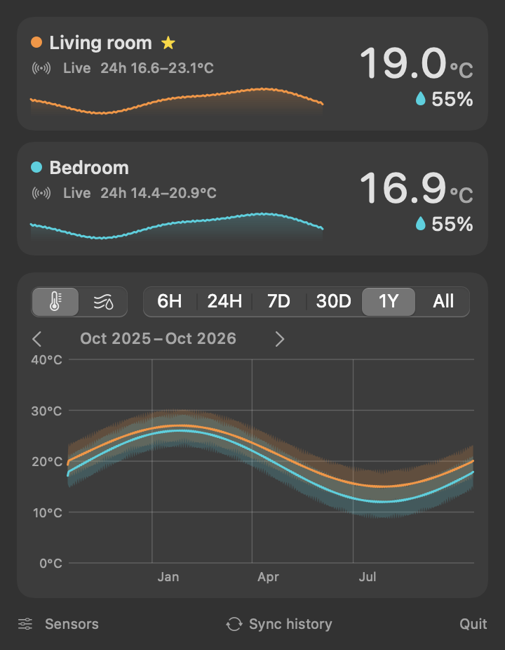

# sensor-tray

A native macOS menu bar app for Bluetooth thermo-hygrometers and Wi-Fi air purifiers. It shows the temperature and humidity of your main sensor in the menu bar (and, if you have one outside, the outdoor sensor next to it), and a click opens every sensor with a chart of its history. It replaces juggling the Govee and ThermoPro phone apps.

<p align="center">
  
</p>

## Supported sensors

| Brand | Models | Live readings | Onboard history |
|---|---|---|---|
| Govee | H5075, H5072 | ✓ (advertisements, every few seconds) | ✓ 20 days, minute resolution |
| ThermoPro | TP357S | ✓ | ✓ 20 days, minute resolution |
| ThermoPro | TP357 / other TP3xx | ✓ | ✓ 24 h by minute + 7 days hourly |
| Philips (Air+ app) | AC0850/70 (800i), likely other Air+ CoAP models | ✓ PM2.5, allergen index, mode, filter life, over Wi-Fi | recorded by the app every minute |

You can add as many sensors of these models as you like and name them.

## Features

- **Menu bar**: the main (★) sensor's `25.1°  62%`, dimmed when the reading is more than 10 minutes old.
- **Indoor vs outdoor**: mark a sensor as outdoor (the tree button in the Sensors window) and the menu bar shows both at a glance, each dimmed on its own when stale. Pick the layout under **Menu bar** in the Sensors window: **Stacked** (the default and narrowest: indoor on the top line, outdoor below), **Columns** (humidity in small type over each temperature, like a CPU meter) or **Side by side** (full size). Every indoor card shows how that room compares with outside (`+1.6°C  −12% vs 🌳`: indoor minus outdoor).
- **Popover**: a card per sensor (temperature, humidity, battery, min–max and a sparkline) and a combined chart with a temperature/humidity toggle and a hover read-out. The card sparklines share one time axis and width, so they can be compared straight down the column. They show the last 24 hours by default; choose 15m, 1h, 3h, 6h or 12h under **Card charts** in the Sensors window. Gaps (Mac asleep, sensor out of range) show as breaks in the chart, not misleading straight bridges.
- **History for as long as you run it**: every minute reading is kept, with no expiry. Choose **6H / 24H / 7D / 30D / 1Y / All**, then step back with **‹ ›**, drag the chart, or swipe sideways on the trackpad to move through time; **Now** jumps back to the present. At 1Y and All, each sensor also gets a shaded daily min–max band, so seasonal changes stand out.
- **Event markers**: press **Mark** above the chart when something happens (windows opened, heating off). A flag stays at that moment on the chart and on every card's sparkline as time moves on, with the time after it shaded. A strip under the chart shows each sensor's change since then (`Living room 26.0°C → 25.4°C −0.6°C`). Label a marker with a preset or your own words, click a flag to focus it, or hover to see its label. Markers are kept with the history.
- **Calibration**: different brands disagree, often by several percent humidity. Put two thermometers side by side for a few hours, then in **Sensors → Calibrate sensors…** choose the one to correct, the one it should match, and when they were together. A live preview shows the measured difference and the fitted correction before you save. Corrections apply everywhere (cards, menu bar, comparisons, charts, markers, plus extra CSV columns), and a **Calibrated** switch in the popover shows the raw readings instead. Each calibrated card also has its own mini switch next to the name, to compare one sensor raw and corrected. Stored readings are never changed.
- **History backfill**: on launch, on wake, every 6 hours and on demand, the app connects briefly to each sensor and downloads only the stretch of its onboard memory that's missing locally, then disconnects so the phone apps keep working. If a sensor doesn't connect (weak signal), it retries 10 minutes later.
- **Air purifiers**: Philips Air+ purifiers are read locally over Wi-Fi, without the Philips cloud or your Philips account. A card shows PM2.5 with an air-quality level (Good / Fair / Poor / Very poor), the allergen index, the mode, and filter warnings ("Replace the filter"), and the chart gets a PM2.5 view. It's read-only; Sensor Tray never changes the purifier's settings.
- **Sensors window**: add nearby sensors (with signal bars, so you can tell which is which), rename, pick each sensor's color (click its dot), reorder, choose the menu bar sensor and the outdoor one, export history as CSV, and remove. It also opens the Calibration window. It also has a launch-at-login toggle.
- Live data is read passively from Bluetooth advertisements, so no pairing is needed. Everything stays on this Mac in `~/Library/Application Support/SensorTray/sensortray.sqlite`, at about 8 MB per sensor per year.

## How calibration works

For each corrected sensor, against the reference you pick:

1. **Pair** the two sensors' minute readings from each side-by-side session, skipping the first 30 minutes (adjustable) while the moved sensor settles, and average them per 10 minutes. This smooths out each brand's response speed and its 0.1° / 1% rounding.
2. **Fit** the difference `reference − raw`, separately for temperature and humidity, as a line in the raw reading: `correction(x) = offset + slope · (x − x̄)`. A Theil–Sen line (the median of pairwise slopes) first flags outliers more than 3 robust standard deviations away, such as the sensor being picked up. The final line is then a least-squares fit to the remaining pairs.
3. **Only fit a slope when the data supports one**: the readings must span at least 3 °C or 10 %RH. Otherwise the correction is a constant offset (the median difference). Slopes are capped at ±0.2.
4. **Pool sessions**: several sessions (say, a cool day and a warm day) are fitted together, so the correction can change with temperature. Beyond the calibrated range it holds at its edge value instead of extrapolating.
5. **Chains** work: if A matches B and B matches C, A is fitted to B's corrected readings. Cycles can't be created.

The window reports how much of a difference is left after correcting (RMS). For example, a TP357S against an H5075 over one day came out at −0.10 °C and +7.2 %RH, with ±0.08 °C and ±0.6 % left.

## Storage & performance

- **Compact rows**: one row per sensor-minute, with an integer sensor key and °C / %RH stored as integer tenths (about 20 bytes a row including the rollup, versus about 95 in 0.1.x). Older databases are migrated automatically on first launch.
- **Hourly rollup**: a `hourly` table (count, sum, min, max) is updated with every write, so 30D / 1Y / All read about 8,760 rows per year instead of 525,600. Ranges up to 7 days read minute rows directly.
- **Bounded charts**: every range is bucketed to 400 points or fewer per sensor (1 min … 2 weeks per point), however many years are stored.
- **Off the main thread**: chart queries run on a background queue over a separate read-only SQLite connection (WAL mode). Requests coalesce, so dragging through months only ever runs the most recent query. Hovering and the chart's marks don't query the database at all.
- Measured by `swift run SensorTrayChecks` on a synthetic year (525,600 minutes): insert in ~0.9 s, 20 bytes/minute, every range queried in ≤ 2 ms, and no memory growth over 1,800 consecutive chart loads.

<p align="center">
  <br>
  <sub>1Y view (generated sample data, via <code>--generate-demo</code>)</sub>
</p>

<p align="center">
  
</p>

## Download & install

**[⬇ Download Sensor Tray for macOS](https://github.com/nuwanprabhath/sensor-tray/releases/latest/download/Sensor-Tray-macOS.zip)**. It's a universal build for Apple Silicon and Intel and needs macOS 14 Sonoma or later. All versions are on the [Releases](https://github.com/nuwanprabhath/sensor-tray/releases) page.

1. Unzip it and drag **Sensor Tray.app** into **Applications**.
2. Open it. The app is ad-hoc signed, not notarized by Apple, so macOS blocks the first launch. Go to **System Settings → Privacy & Security**, scroll down, and click **Open Anyway** next to "Sensor Tray". Or, in Terminal:
   ```sh
   xattr -dr com.apple.quarantine "/Applications/Sensor Tray.app"
   ```
3. Allow **Bluetooth** when asked, and **Local Network** if you have an air purifier. A thermometer and reading appear in the menu bar.
4. Click it → **Sensors…** → **Add** your sensors (and purifiers) under *Nearby*, and name them. History from the sensors' memory downloads in the background (about a minute per sensor).

To start it at login, turn on **Launch at login** in the Sensors window.

## Build from source

Requires macOS 14+ and the Xcode Command Line Tools.

```sh
./build.sh
open "dist/Sensor Tray.app"                     # run it
cp -R "dist/Sensor Tray.app" /Applications/     # install
```

## Releasing

Every push of a `v*` tag runs [the release workflow](.github/workflows/release.yml) on a macOS runner. It runs the checks, builds a universal ad-hoc-signed app, and publishes a GitHub Release with `Sensor-Tray-macOS.zip`, using the tag's `CHANGELOG.md` section as release notes.

1. Bump `VERSION` and add a `## x.y.z` section to `CHANGELOG.md`.
2. Commit, then `git tag vx.y.z && git push origin main vx.y.z`. The workflow fails if the tag doesn't match `VERSION`.

`./scripts/package-release.sh` builds the same zip locally (add `--universal` with full Xcode). Running the workflow manually (*Actions → Release → Run workflow*) is a dry run that uploads the zip as a workflow artifact without releasing.

## CLI / development

The same binary doubles as a test tool:

```sh
.build/release/SensorTray --scan [seconds]            # list nearby sensors with live readings + advert counts
.build/release/SensorTray --history <uuid> [minutes]  # download a sensor's onboard history
.build/release/SensorTray --dump                      # configured sensors and stored data
.build/release/SensorTray --purifier [seconds]        # find Philips purifiers and print their status updates
.build/release/SensorTray --generate-demo /tmp/demo.sqlite 2   # 2 years of synthetic minute data
SENSORTRAY_DB=/tmp/demo.sqlite .build/release/SensorTray        # run the app (or any flag) against it
.build/release/SensorTray --snapshot docs/screenshot-dark.png dark [sensors] [--range 1Y]   # render the UI to PNG
SENSORTRAY_DEBUG=1 .build/release/SensorTray --scan   # print raw advertisement bytes
swift run SensorTrayChecks                            # protocol, storage, migration, chart-window and performance checks
```

`SensorTrayChecks` is a plain assertion runner, because XCTest and swift-testing need a full Xcode install. For the same reason the SwiftUI views use a small `ViewState` object instead of `@State`, which is a macro on the macOS 27 SDK and has no plugin in the Command Line Tools.

## Protocol notes

- **Govee H5075** advertises two manufacturer records, `88 EC 00 T2 T1 T0 BB 00` and an Apple iBeacon, and CoreBluetooth concatenates them into one blob. `T2T1T0` is one decimal number, `TTTHHH`: `0x03D6E3` = 251619 → 25.1 °C, 61.9 %. History uses the `494e5445-4c4c-495f-524f-434b535f…` ("INTELLI_ROCKS") service: write `33 01 <minutes-back> 00 01 … xor` to `…2012`, and records stream back on `…2013` six per packet. Based on [GoveeBTTempLogger](https://github.com/wcbonner/GoveeBTTempLogger).
- **ThermoPro** puts the reading straight into the manufacturer data (the "company id" bytes included): `Int16LE temp/10`, humidity, battery level. The TP357 history opcodes are `a7`/`a6`; the TP357S needs an `a5` time-sync handshake followed by `cccc…6666`-framed requests. Based on [thermopro-ble](https://github.com/Bluetooth-Devices/thermopro-ble), [tpy357](https://github.com/alexpacini/tpy357) and [pasky/tp357](https://github.com/pasky/tp357).
- **Philips Air+ purifiers** speak encrypted CoAP on UDP 5683.
  - Discovery is a plaintext `GET /sys/dev/info` sent to multicast 224.0.1.187 and the subnet broadcast. macOS 27 hides the ARP table, so a MAC address can't be used to find the device.
  - The session is `POST /sys/dev/sync`, then `GET /sys/dev/status` with Observe=0.
  - Each notification is `KEY + AES-128-CBC ciphertext + SHA-256`, with the key and IV taken from `MD5("JiangPan" + KEY)`.
  - The purifier only reports **changes**, so the app keeps the last report and records it every minute while empty-CON pings show the device is reachable.
  - Based on [aioairctrl](https://github.com/kongo09/aioairctrl) and [philips-airpurifier-coap](https://github.com/kongo09/philips-airpurifier-coap).
  - Only one app per Mac receives a purifier's updates (the newest subscription wins).
- Background (menu bar) apps on macOS scan passively, so a sensor's name, which arrives in its scan response, is often missing. Govee units are recognised by their manufacturer data, and configured sensors by their stored Bluetooth identifier.
